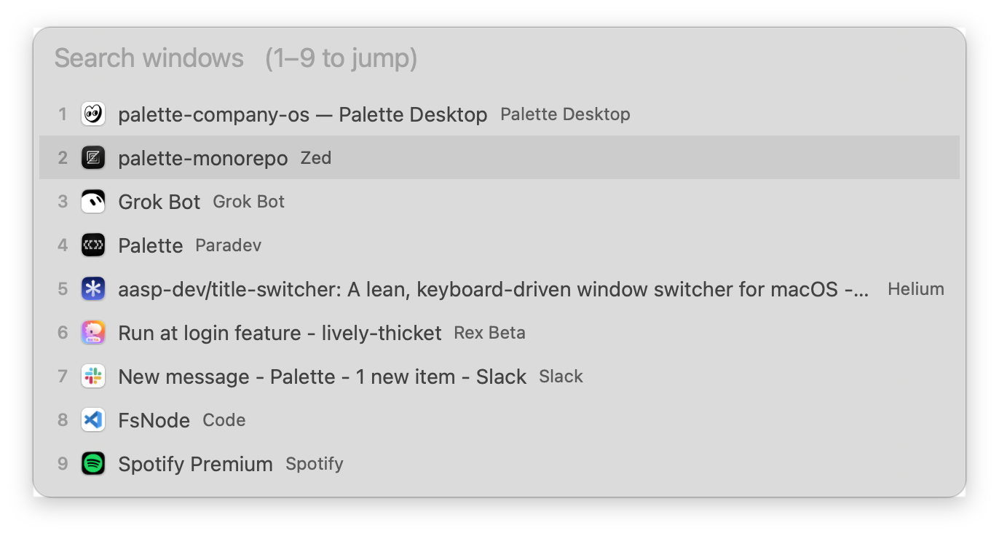

# TitleSwitcher

A lean, keyboard-driven window switcher for macOS: press a shortcut, get a list of window titles, type to search, hit return.



## Features

- Lists every window by title in front-to-back order (most recent first), not grouped by app
- Predictable search: every word you type must appear in the window title or app name
- Number keys jump straight to a row
- Only needs the Accessibility permission (no Screen Recording, no Input Monitoring)
- Lives in the menu bar and has no Dock icon

## Usage

| Key | Action |
| --- | --- |
| **⌥⇥** | Open the palette |
| **⌥⇥** again, **⇥**, **↓** | Move down |
| **⇧⇥**, **↑** | Move up |
| **1–9** | Focus that row (works while still holding ⌥) |
| *type* | Filter by window title or app name |
| **↩** | Focus the selected window |
| **⎋** | Close the palette |

With no query, row 2 (your previous window) is preselected, so **⌥⇥ ↩** toggles between your two most recent windows.

TitleSwitcher lists the windows on the current Space, plus minimized ones.

## Requirements

- macOS 14 (Sonoma) or later
- Swift 5.9+ (Xcode 15 or the Command Line Tools)

## Install

Download `TitleSwitcher.zip` from the [latest release](https://github.com/aasp-dev/title-switcher/releases/latest), unzip it, and move `TitleSwitcher.app` to `/Applications`.

The app is not notarized, so macOS blocks it the first time. Clear the quarantine flag once:

```sh
xattr -dr com.apple.quarantine /Applications/TitleSwitcher.app
open /Applications/TitleSwitcher.app
```

### Build from source

```sh
git clone https://github.com/aasp-dev/title-switcher.git
cd title-switcher
./scripts/bundle.sh                         # builds build/TitleSwitcher.app
cp -R build/TitleSwitcher.app /Applications/
open /Applications/TitleSwitcher.app
```

On first launch, macOS asks you to grant Accessibility access in **System Settings → Privacy & Security → Accessibility**. TitleSwitcher needs it to read window titles and focus windows.

The bundle is ad-hoc signed by default, so macOS treats every rebuild as a new app and asks for Accessibility again. To avoid that, sign with a stable certificate:

```sh
SIGN_IDENTITY="Apple Development: Your Name (TEAMID)" ./scripts/bundle.sh
```

To start TitleSwitcher at login, add it under **System Settings → General → Login Items**.

## Development

```sh
swift test              # run the core logic tests
swift build             # debug build
./scripts/bundle.sh     # release .app bundle
```

To publish a release, push a version tag. CI runs the tests, builds the app, and attaches `TitleSwitcher.zip` to a GitHub Release:

```sh
git tag v0.1.0 && git push origin v0.1.0
```

The code is split into two targets:

- `SwitcherCore`: pure, tested logic (filtering, ordering, initial selection, digit keys)
- `TitleSwitcher`: the AppKit app (hotkey, palette UI, Accessibility window source)

## License

[MIT](LICENSE)
